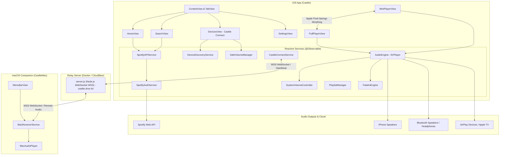

# Castlie — Проєктний План iOS Екосистеми

> **Примітка (2026-10-11):** архітектуру плеєра та Safe Volume Handoff перероблено — `FullPlayerView`, `MiniPlayerView`, `FadeInEngine`, `NightModeManager`, `ThemeManager` більше не існують. Актуальний опис — останній запис журналу в `progress.md`.

## Огляд Проєкту

**Castlie** — це передовий музичний плеєр та аудіо-екосистема для iOS та macOS, серцем якої є технологія **Safe Volume Handoff** — інтелектуальне та безпечне перемикання аудіопотоку на зовнішні пристрої (Bluetooth-колонки, навушники, телевізори, AirPlay-ресивери та комп'ютери Mac) з обов'язковим попереднім контролем та обмеженням гучності. Музичний каталог підтягується через офіційний **Spotify Web API** (30-секундні прев'ю треків, метадані та високоякісні обкладинки альбомів).

Проєкт розроблено на основі емпіричного UX-дослідження взаємодії зі Spotify Connect та аудіосистемами:

| Проблема з дослідження | Реальне рішення в Castlie |
|---|---|
| Непередбачуваний рівень гучності при підключенні (П2, П9) | **Попередній перегляд і регулювання гучності ДО підключення** + діалог підтвердження `HandoffConfirmSheet` |
| Страх раптового оглушливого звуку (П2) | **Попередній контроль гучності** та обов'язковий підкапотний Fade-in |
| Зовнішня колонка оглушливо грає на своєму старому рівні | **Підкапотний софтверний Fade-in** (плавне наростання звуку 0.0 → 1.0) без зсуву системного повзунка |
| Хибний workaround: скручування звуку на телефоні перед підключенням | **Історія пристроїв** із запам'ятовуванням бажаного рівня для кожного гаджета окремо |
| Радикальні дії при збої (вимикання/вмикання Bluetooth) | Прозоре керування маршрутами, відновлення останнього пристрою та витончене керування виводом |
| Відсутність синхронного керування звуком між iPhone та Mac | Власна мережева шина **Castlie Connect** через WebSocket-релей (`castlie.dron.lol`) |

---

## Технічний Стек

| Компонент | Технологія / Інструмент | Деталі реалізації |
|---|---|---|
| **Платформа** | iOS 18.0+ / 26.0+ (iOS SDK 27), macOS 15.0+ | Підтримка iPhone, iPad та нативного Mac MenuBar додатку |
| **Мова програмування** | Swift 6.0 | Сувора безпека конкурентності (Strict Concurrency Checking, `Sendable`, `@MainActor`) |
| **UI Framework** | SwiftUI | Сучасна архітектура, Apple Liquid Glass (`.glassEffect`), Apple Fluid Springs |
| **Архітектура** | MVVM + Direct Service Reactivity | Використання макросу `@Observable`, скорочення зайвих проміжних обгорток |
| **Аудіо-движок** | AVFoundation (`AVPlayer`, `AVAudioSession`) | Фонове відтворення (`.playback`, `.longFormAudio`), `MPNowPlayingInfoCenter`, переривання |
| **Керування гучністю** | `SystemVolumeController` + `FadeInEngine` | On-demand `MPVolumeView` для збереження системної шторки iOS + софтверний гейн для fade-in |
| **Виявлення пристроїв** | `AVAudioSession` + `AVRouteDetector` | Відстеження реальних апаратних маршрутів та доступності AirPlay без мок-заглушок |
| **Мережевий релей** | WebSocket (WSS) + Node.js | Релей-сервер на базі Docker (`wss://castlie.dron.lol/ws?roomId=default`) з heartbeat-пінгами |
| **Mac-клієнт** | macOS `MenuBarExtra` | Нативний фоновий супутник у статус-барі macOS (`CastlieMac`) |
| **Музичний каталог** | Spotify Web API | Client Credentials Flow з автооновленням токена, кешування обкладинок |
| **Зберігання даних** | `UserDefaults` / JSON Encoding | Персистентність налаштувань безпеки, історії пристроїв та плейлистів користувача |
| **Іконки та стиль** | SF Symbols (100%) | Жодних емоджі в коді та UI, строго відповідні системні символи Apple |
| **Мова інтерфейсу** | Українська | Повна локалізація інтерфейсу користувача |

---

## Архітектура Екосистеми

Castlie — це розподілена система, що об'єднує клієнтський додаток iPhone, нативний фоновий плеєр Mac та хмарний релей:



---

## Структура Проєкту

Реальна структура репозиторію з усіма модулями, сервісами та супутніми таргетами:

```
Safe-Volume-Handoff/
├── project.yml                          # Конфігурація генерації Xcode-проєкту (XcodeGen)
├── Castlie.xcodeproj                    # Згенерований проєкт Xcode
├── Dockerfile                           # Docker-контейнер релей-сервера
│
├── Castlie/                             # Головний таргет iOS-додатку
│   ├── CastlieApp.swift                 # Точка входу, налаштування системного URLCache
│   ├── ContentView.swift                # Корінь UI: TabView + інтерактивний морфінг-плеєр
│   ├── Info.plist                       # Дозволи Bluetooth, аудіо-фоновий режим
│   │
│   ├── Theme/
│   │   ├── ThemeManager.swift           # @Observable менеджер палітри кольорів
│   │   └── AppFonts.swift               # Системні шрифти з округлим дизайном (.rounded)
│   │
│   ├── Models/
│   │   ├── Track.swift                  # Уніфікована модель треку
│   │   ├── AudioDevice.swift            # Модель пристрою (iPhone, Mac, Speaker, TV тощо)
│   │   ├── DeviceHistory.swift          # Запис історії підключення з рівнем гучності
│   │   ├── Playlist.swift               # Модель користувацького плейлиста
│   │   ├── SafeVolumeConfig.swift       # Конфігурація порогів безпеки та fade-in
│   │   └── SpotifyModels.swift          # DTO моделі відповідей Spotify API
│   │
│   ├── ViewModels/
│   │   ├── DeviceManagerViewModel.swift # Координатор стану пристроїв та handoff-підключення
│   │   ├── HomeViewModel.swift          # Завантаження релізів та персональних рекомендацій
│   │   ├── SearchViewModel.swift        # Пошук по каталогу з 0.5с debounce
│   │   └── SettingsViewModel.swift      # Менеджмент збереження налаштувань
│   │
│   ├── Services/
│   │   ├── AudioEngine.swift            # Ядро AVPlayer: відтворення, черга, NowPlaying, переривання
│   │   ├── CastlieConnectService.swift  # Клієнт зв'язку з Mac через WebSocket релей-сервер
│   │   ├── DeviceDiscoveryService.swift # Відстеження апаратних аудіо-маршрутів та AirPlay
│   │   ├── SafeVolumeManager.swift      # Логіка рівнів безпеки, розрахунок рекомендованої гучності
│   │   ├── FadeInEngine.swift           # Софтверний fade-in (software gain 0.0 -> 1.0)
│   │   ├── SystemVolumeController.swift # On-demand активація MPVolumeView для збереження HUD
│   │   ├── PlaylistManager.swift        # Локальне збереження улюблених треків та плейлистів
│   │   ├── SpotifyAPIService.swift      # HTTP-запити до каталогів та альбомів Spotify
│   │   ├── SpotifyAuthService.swift     # Авторизація Client Credentials Flow з авторефрешем
│   │   └── HapticFeedbackService.swift  # Тактильний відгук (UIImpactFeedbackGenerator)
│   │
│   ├── Views/
│   │   ├── Home/
│   │   │   ├── HomeView.swift           # Головний екран: каруселі, мікси, плейлисти
│   │   │   ├── NewReleasesSection.swift # Горизонтальний скрол нових альбомів
│   │   │   ├── TrackCardView.swift      # Картка треку/альбому для каруселей
│   │   │   └── AlbumDetailView.swift    # Детальний перегляд трек-листа вибраного альбому
│   │   │
│   │   ├── Search/
│   │   │   ├── SearchView.swift         # Пошуковий інтерфейс з результатами
│   │   │   └── SpotifyTrackRow.swift    # Рядок треку з обкладинкою та індикатором відтворення
│   │   │
│   │   ├── Player/
│   │   │   ├── FullPlayerView.swift     # Повноекранний плеєр з адаптивним градієнтом
│   │   │   ├── MiniPlayerView.swift     # Інтерактивна капсула міні-плеєра (Liquid Glass)
│   │   │   ├── AlbumArtView.swift       # Велика обкладинка з екстракцією палітри
│   │   │   ├── PlaybackControlsView.swift # Контроли play/pause/skip з хаптиком
│   │   │   ├── ProgressBarView.swift    # Інтерактивний скруббер таймлайну
│   │   │   └── VolumeSliderView.swift   # Слайдер гучності з колірною індикацією безпеки
│   │   │
│   │   ├── Devices/
│   │   │   ├── DevicesView.swift        # Екран Castlie Connect: вибір та контроль виводу
│   │   │   └── HandoffConfirmSheet.swift# Діалог підтвердження безпечного підключення
│   │   │
│   │   ├── Playlists/
│   │   │   └── PlaylistView.swift       # Екран перегляду та керування плейлистом
│   │   │
│   │   └── Settings/
│   │       ├── SettingsView.swift       # Меню налаштувань у стилі iOS Settings
│   │       ├── FadeInSettings.swift     # Тривалість плавного наростання
│   │       └── AboutView.swift          # Довідка про проєкт та академічне дослідження
│   │
│   ├── Components/
│   │   ├── AirPlayPickerButton.swift    # UIViewRepresentable міст до AVRoutePickerView
│   │   ├── AnimatedWaveform.swift       # Синусоїдальний живий еквалайзер на TimelineView
│   │   ├── GlowingButton.swift          # Кнопка з пульсуючим неоновим ореолом
│   │   └── SafetyIndicator.swift        # Бейдж статусу гучності (безпечно / увага / небезпечно)
│   │
│   └── Extensions/
│       ├── Color+DominantColor.swift    # Екстракція домінантного кольору з NSCache
│       ├── Color+Hex.swift              # Ініціалізатор Color з hex-рядка
│       └── View+Transitions.swift       # Утилітарні модифікатори карток та анімацій
│
├── CastlieMac/                          # Таргет супутнього Mac MenuBar додатку
│   ├── CastlieMacApp.swift              # Точка входу macOS додатку з MenuBarExtra
│   ├── Package.swift                    # Swift Package конфігурація
│   ├── Services/
│   │   ├── MacReceiverService.swift     # WSS клієнт обробки команд від iPhone
│   │   └── MacAudioPlayer.swift         # Локальне відтворення AVPlayer на Mac
│   └── Views/
│       └── MenuBarView.swift            # Компактне випадаюче вікно керування в Mac статус-барі
│
└── server/                              # Node.js WebSocket релей-сервер
    ├── server.js                        # Маршрутизація кімнат, обробка WSS повідомлень, healthcheck
    └── package.json                     # Залежності ws, http
```

---

## Ключові Архітектурні та Інженерні Рішення

### 1. Пряма реактивність замість зайвих прошарків
У первинному плані передбачався окремий `AudioPlayerViewModel`. На практиці сервіс [AudioEngine.swift](file:///Users/dronchik/Documents/GitHub/Safe-Volume-Handoff/Castlie/Services/AudioEngine.swift) побудований як `@Observable @MainActor` синглтон. Завдяки сучасному макросу `@Observable`, SwiftUI-в'ю напряму спостерігають лише за тими властивостями аудіо-движка, які фактично рендерять. Це усунуло дублювання стану та забезпечило найвищу швидкість відгуку.

### 2. Підкапотний софтверний Fade-in
Замість програмного переміщення системного повзунка iOS (що спантеличувало б користувача стрибками гучності в інтерфейсі), [FadeInEngine.swift](file:///Users/dronchik/Documents/GitHub/Safe-Volume-Handoff/Castlie/Services/FadeInEngine.swift) керує внутрішнім параметром `softwareGain` (від 0.0 до 1.0 з частотою 30 кроків/сек). 
- Повзунок користувача залишається на бажаному рівні (наприклад, 40%).
- Фактичний звук плавно піднімається від абсолютної тиші до встановленого рівня.

### 3. Збереження системної шторки iOS (On-Demand Activation)
При стандартній інтеграції `MPVolumeView` операційна система iOS блокує показ рідного системного оверлею гучності (HUD) при натисканні апаратних бічних клавіш iPhone.
У сервісі [SystemVolumeController.swift](file:///Users/dronchik/Documents/GitHub/Safe-Volume-Handoff/Castlie/Services/SystemVolumeController.swift) застосовано підхід **On-Demand Activation**:
- Прихований `MPVolumeView` приєднується до ієрархії вікна **виключно в момент, коли користувач торкається повзунка у додатку**.
- Через 0.35 секунди після завершення жесту елемент видаляється з вікна.
- Фізичні клавіші iPhone працюють штатно, виводячи красиву системну шторку iOS.

### 4. Відмова від штучних мок-пристроїв
Сервіс [DeviceDiscoveryService.swift](file:///Users/dronchik/Documents/GitHub/Safe-Volume-Handoff/Castlie/Services/DeviceDiscoveryService.swift) працює безпосередньо з системними аудіо-портами iOS:
- Поточний маршрут зчитується з `AVAudioSession.sharedInstance().currentRoute`.
- Зміни відстежуються через системне сповіщення `.routeChangeNotification`.
- Доступність AirPlay у локальній мережі визначається через `AVRouteDetector`.
- Останній активний Bluetooth-гаджет зберігається в пам'яті, щоб користувач міг повернути звук на колонку навіть після тимчасового перемикання на динамік iPhone.

### 5. Мережева шина Castlie Connect та усунення розривів
Для взаємодії з комп'ютером Mac розроблено протокол Castlie Connect:
- iPhone та Mac підключаються до захищеного релей-сервера [server/server.js](file:///Users/dronchik/Documents/GitHub/Safe-Volume-Handoff/server/server.js) через WebSocket (`wss://castlie.dron.lol`).
- Для запобігання обриву з'єднання зворотним проксі Cloudflare реалізовано 15-секундний `ping-heartbeat` таймер.
- iPhone передає URL треку, позицію, статус відтворення та команди безпечної гучності, а Mac повертає свій апаратний рівень звуку.

### 6. Apple Fluid Springs & 120 FPS Morphing Player
Перехід між міні-плеєром та повноекранним плеєром у [FullPlayerView.swift](file:///Users/dronchik/Documents/GitHub/Safe-Volume-Handoff/Castlie/Views/Player/FullPlayerView.swift) реалізовано не як модальне вікно, а як **інтерактивний морфінг єдиного View**:
- Координати, висота, ширина, радіус заокруглення кутів та прозорість розраховуються за формулою лінійної інтерполяції (`lerp`) на основі прогресу свайпу `p` (0.0 — повний екран, 1.0 — міні-капсула).
- Використовуються калібровані пружини Apple Fluid Springs (`response: 0.50`, `dampingFraction: 0.88`).
- Враховано відступ Dynamic Island через апаратні `safeAreaInsets`.
- Капсула міні-плеєра використовує системний стиль Apple Liquid Glass (`.glassEffect(.regular, in: .capsule)`).

### 7. Оптимізація продуктивності та рендеру
- **AnimatedWaveform на TimelineView**: стовпчики еквалайзера анімуються за плавною синусоїдою лише під час відтворення, а при натисканні на паузу миттєво завмирають, зводячи навантаження на процесор до 0% CPU.
- **NSCache для кольорів обкладинок**: розрахунок домінантного відтінку альбому виконується асинхронно зі стисненням до 1x1 пікселя і кешується.
- **Обмеження пам'яті**: на старті додатку в [CastlieApp.swift](file:///Users/dronchik/Documents/GitHub/Safe-Volume-Handoff/Castlie/CastlieApp.swift) встановлено ліміт `URLCache` (40 MB RAM / 150 MB Disk) для запобігання витокам пам'яті при скролі сотень обкладинок.

---

## Опис Екранів та Інтерфейсу

### 1. Головна (Home)
- **Карусель нових релізів ([NewReleasesSection.swift](file:///Users/dronchik/Documents/GitHub/Safe-Volume-Handoff/Castlie/Views/Home/NewReleasesSection.swift))**: відображення свіжих альбомів зі Spotify з можливістю переходу в повний трек-лист [AlbumDetailView.swift](file:///Users/dronchik/Documents/GitHub/Safe-Volume-Handoff/Castlie/Views/Home/AlbumDetailView.swift).
- **Секція «Рекомендації для вас»**: вертикальний список рекомендованих треків на основі популярних жанрів.
- **Швидкий доступ до плейлистів**: плашки «Улюблені треки» та користувацькі плейлисти.

### 2. Пошук (Search)
- Миттєвий рядок пошуку з автоматичним 0.5-секундним debounce для захисту від перевищення лімітів Spotify API.
- Відображення списку треків у компоненті [SpotifyTrackRow.swift](file:///Users/dronchik/Documents/GitHub/Safe-Volume-Handoff/Castlie/Views/Search/SpotifyTrackRow.swift) з анімованим індикатором відтворення, якщо цей трек зараз грає.

### 3. Пристрої (Castlie Connect) — Головний екран
- **Hero Active Output Card**: велика картка поточного джерела відтворення (iPhone / Mac / Bluetooth / AirPlay) з поточною гучністю, назвою та бейджем безпеки.
- **Слайдер прямого контролю**: плавне регулювання гучності активного пристрою в реальному часі.
- **Список доступних пристроїв**: відображення виявлених колонок, Mac-комп'ютерів у мережі та AirPlay-приймачів.
- **Попередній перегляд гучності**: кожна картка показує збережену гучність та дозволяє викликати безпечне підключення.
- **Діалог [HandoffConfirmSheet.swift](file:///Users/dronchik/Documents/GitHub/Safe-Volume-Handoff/Castlie/Views/Devices/HandoffConfirmSheet.swift)**:
  - Відображає назву цільового пристрою.
  - Дозволяє відрегулювати стартовий звук ДО фактичного перемикання аудіо.
  - Попереджає про підвищену або небезпечну гучність (жовта/червона зона).
  - Містить кнопку `Підключити безпечно` з неоновим свіченням [GlowingButton.swift](file:///Users/dronchik/Documents/GitHub/Safe-Volume-Handoff/Castlie/Components/GlowingButton.swift).
- **AirPlay Picker**: системна кнопка виклику меню аудіовиводу iOS через [AirPlayPickerButton.swift](file:///Users/dronchik/Documents/GitHub/Safe-Volume-Handoff/Castlie/Components/AirPlayPickerButton.swift).

### 4. Плеєр (Міні-капсула та Повноекранний вигляд)
- **Міні-плеєр ([MiniPlayerView.swift](file:///Users/dronchik/Documents/GitHub/Safe-Volume-Handoff/Castlie/Views/Player/MiniPlayerView.swift))**:
  - Розміщується над панеллю вкладок.
  - Обкладинка, назва треку, виконавець або бейдж пристрою, кнопки Play/Pause, Next.
  - Нижня неонова смуга прогресу з рухомою цяткою `Liquid Playhead Bead`.
  - Плаваюча підказка Spotify Connect (`SpotifyDeviceCalloutView`) з дзьобиком-стрілкою, яка підказує, де грає музика.
- **Повноекранний плеєр ([FullPlayerView.swift](file:///Users/dronchik/Documents/GitHub/Safe-Volume-Handoff/Castlie/Views/Player/FullPlayerView.swift))**:
  - Динамічний градієнт фону під колір обкладинки.
  - Індикатор безпечної гучності та іконка поточного пристрою.
  - Кнопка додавання до «Улюблених» (`heart.fill`).
  - Повний скруббер часу, кнопки Shuffle та Repeat.

### 5. Налаштування (Settings)
- Оформлений у фірмовому стилі системних параметрів Apple (груповані списки, кольорові іконки-бейджи).
- **Fade-in**: увімкнення та вибір тривалості від 0.5 до 5.0 секунд.
- **Підключення та Handoff**: опція «Запитувати підтвердження» та налаштування домену сервера Castlie Connect.
- **Сервер Castlie Connect**: налаштування адреси релей-сервера.
- **Про додаток ([AboutView.swift](file:///Users/dronchik/Documents/GitHub/Safe-Volume-Handoff/Castlie/Views/Settings/AboutView.swift))**: інформація про розробку та результати лабораторного дослідження.

---

## Моделі Даних та Парсинг

### 1. Доменні моделі
- [AudioDevice.swift](file:///Users/dronchik/Documents/GitHub/Safe-Volume-Handoff/Castlie/Models/AudioDevice.swift): структура пристрою з переліком `DeviceType` (`.iPhone`, `.mac`, `.speaker`, `.tv`, `.headphones`, `.airplay`, `.bluetooth`) та `ConnectionType`.
- [Track.swift](file:///Users/dronchik/Documents/GitHub/Safe-Volume-Handoff/Castlie/Models/Track.swift): уніфікований трек з назвою, виконавцем, посиланням на обкладинку та `previewURL`.
- [SafeVolumeConfig.swift](file:///Users/dronchik/Documents/GitHub/Safe-Volume-Handoff/Castlie/Models/SafeVolumeConfig.swift): стан конфігурації безпеки та параметри плавного старту (Fade-in).
- [DeviceHistory.swift](file:///Users/dronchik/Documents/GitHub/Safe-Volume-Handoff/Castlie/Models/DeviceHistory.swift): збережені записи `DeviceHistoryEntry` для автоматичного відновлення гучності.
- [Playlist.swift](file:///Users/dronchik/Documents/GitHub/Safe-Volume-Handoff/Castlie/Models/Playlist.swift): модель користувацького списку відтворення.

### 2. DTO парсинг Spotify API ([SpotifyModels.swift](file:///Users/dronchik/Documents/GitHub/Safe-Volume-Handoff/Castlie/Models/SpotifyModels.swift))
- Використовує `JSONDecoder.keyDecodingStrategy = .convertFromSnakeCase`.
- DTO структури: `SpotifyAuthResponse`, `SpotifySearchResponse`, `SpotifyTrack`, `SpotifyAlbum`, `SpotifyArtist`, `SpotifyImage`, `SpotifyNewReleasesResponse`.
- Функція-мапер `toTrack()` для безшовної конвертації відповіді API у внутрішню модель додатку.

### 3. Протокол WebSocket повідомлень (Castlie Connect)
Обмін JSON-повідомленнями через релей-сервер:
```json
// Реєстрація пристрою
{ "type": "register", "deviceId": "...", "deviceName": "...", "role": "sender" | "receiver", "volume": 0.4 }

// Команда передачі аудіо на Mac
{ "type": "play_track", "track": { "id": "...", "name": "...", "previewURL": "..." }, "targetDeviceId": "mac_123" }

// Оновлення гучності
{ "type": "volume_change", "volume": 0.35, "targetDeviceId": "mac_123" }

// Статус та Heartbeat
{ "type": "ping" } -> { "type": "pong" }
```

---

## Статус Фаз та Прогрес Розробки

### Фази 1–6 (Базовий функціонал та Полірування) — ПОВНІСТЮ ЗАВЕРШЕНО ✅
- [x] **Фаза 1: Фундамент** — XcodeGen, архітектура, моделі даних, `ThemeManager`, `AppFonts`, базовий таб-бар.
- [x] **Фаза 2: Аудіо та Spotify** — `SpotifyAuthService`, `SpotifyAPIService`, `AudioEngine` на AVPlayer, `FadeInEngine`, `SafeVolumeManager`.
- [x] **Фаза 3: UI Головна та Пошук** — `HomeView` з каруселями, `SearchView` з 0.5с debounce, `SpotifyTrackRow`.
- [x] **Фаза 4: Інтерактивний Плеєр** — морфінг-плеєр, екстракція кольору з обкладинки, жести закриття, таймлайн та контроли.
- [x] **Фаза 5: Safe Volume Handoff** — `DeviceDiscoveryService` на системних маршрутах, `DevicesView`, `HandoffConfirmSheet`, розрахунок безпеки.
- [x] **Фаза 6: Екосистема, Налаштування та Полірування**:
  - Налаштування у стилі Apple Settings.
  - On-demand активація `MPVolumeView` у `SystemVolumeController` для захисту системного HUD.
  - Mac MenuBar додаток `CastlieMac` та WebSocket релей `castlie.dron.lol`.
  - 15-секундний heartbeat проти таймаутів Cloudflare.
  - Оптимізація 120 FPS ProMotion, обмеження пам'яті кешу зображень.
  - Живий еквалайзер `AnimatedWaveform` на `TimelineView` (0% CPU на паузі).
  - Повна відповідність Swift 6 Strict Concurrency.


