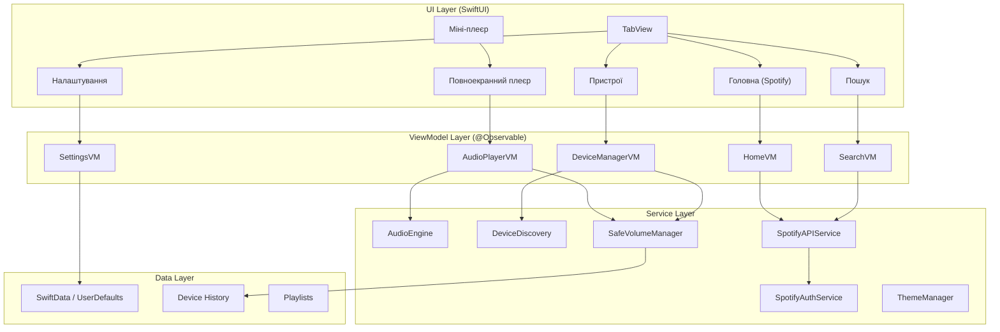

# Castlie — Проєктний План iOS Додатку

## Огляд Проєкту

**Castlie** — повноцінний музичний плеєр для iOS, головною фішкою якого є **Safe Volume Handoff** — безпечне перемикання аудіо на зовнішні пристрої з попереднім контролем гучності. Музика підтягується через **Spotify Web API** (30-секундні прев'ю треків з якісними обкладинками).

Додаток вирішує реальні проблеми, виявлені в [дослідженні Spotify Connect](file:///Users/dronchik/Documents/GitHub/Safe-Volume-Handoff/Лаба%201%20ЛМВ.pdf):

| Проблема з дослідження | Наше рішення |
|---|---|
| Непередбачуваний рівень гучності при підключенні (П2, П9) | Попередній перегляд гучності + діалог підтвердження |
| Страх раптового гучного звуку ввечері | Night Mode з автоматичним обмеженням гучності |
| Колонка грає на своєму попередньому рівні | Fade-in + максимальний поріг |
| Хибний workaround: скручування гучності телефону | Історія пристроїв із запам'ятовуванням рівня |

---

## Технічний Стек

| Компонент | Технологія |
|---|---|
| Платформа | iOS 26+ |
| Мова | Swift 6 |
| UI Framework | SwiftUI |
| Архітектура | MVVM + `@Observable` macro |
| Аудіо | AVFoundation (AVPlayer для Spotify прев'ю) |
| Пристрої | AVRoutePickerView (AirPlay) + CoreBluetooth |
| Музика | Spotify Web API (30с прев'ю треків) |
| Зберігання | SwiftData / UserDefaults |
| Іконки | SF Symbols (без емоджі) |
| Мова інтерфейсу | Українська |

---

## Тестування на iPhone

> [!TIP]
> **Безкоштовне тестування на фізичному iPhone** — повністю можливо!
> 
> 1. Створіть безкоштовний Apple ID
> 2. Додайте його в Xcode → Settings → Accounts
> 3. В проєкті виберіть Team → ваш Personal Team
> 4. Підключіть iPhone кабелем, натисніть Run
> 5. На iPhone: Settings → General → VPN & Device Management → Trust
> 
> **Обмеження**: додаток потрібно перевстановлювати кожні 7 днів, максимум 3 активні додатки.

---

## Архітектура Додатку



---

## Структура Проєкту

```
Castlie/
├── CastlieApp.swift                     # Точка входу
├── ContentView.swift                    # TabView + міні-плеєр
│
├── Theme/
│   ├── ThemeManager.swift               # Система тем (не захардкоджена)
│   ├── AppColors.swift                  # Палітра кольорів
│   └── AppFonts.swift                   # Типографіка
│
├── Models/
│   ├── Track.swift                      # Уніфікована модель треку
│   ├── Playlist.swift                   # Модель плейлиста
│   ├── AudioDevice.swift                # Модель аудіопристрою
│   ├── DeviceHistory.swift              # Історія підключень з гучністю
│   ├── SafeVolumeConfig.swift           # Конфігурація safe mode
│   └── SpotifyModels.swift              # Моделі для Spotify API відповідей
│
├── ViewModels/
│   ├── AudioPlayerViewModel.swift       # Керування відтворенням
│   ├── DeviceManagerViewModel.swift     # Виявлення та підключення пристроїв
│   ├── HomeViewModel.swift              # Головна: нові релізи, рекомендації
│   ├── SearchViewModel.swift            # Пошук по Spotify
│   └── SettingsViewModel.swift          # Налаштування
│
├── Services/
│   ├── AudioEngine.swift                # AVPlayer для Spotify прев'ю
│   ├── DeviceDiscoveryService.swift     # AirPlay + Bluetooth discovery
│   ├── SafeVolumeManager.swift          # КЛЮЧОВИЙ: логіка safe handoff
│   ├── FadeInEngine.swift               # Плавне наростання гучності
│   ├── NightModeManager.swift           # Часовий профіль
│   ├── SpotifyAPIService.swift          # HTTP-клієнт для Spotify Web API
│   ├── SpotifyAuthService.swift         # OAuth 2.0 Client Credentials flow
│   └── HapticFeedbackService.swift      # Вібрація при подіях
│
├── Views/
│   ├── Home/
│   │   ├── HomeView.swift               # Головна: нові релізи, категорії
│   │   ├── TrackCardView.swift          # Картка треку з обкладинкою
│   │   ├── NewReleasesSection.swift     # Секція нових релізів
│   │   └── PlaylistView.swift           # Вигляд плейлиста
│   │
│   ├── Search/
│   │   ├── SearchView.swift             # Пошук по Spotify
│   │   ├── SearchResultsView.swift      # Результати пошуку
│   │   └── SpotifyTrackRow.swift        # Рядок треку з обкладинкою
│   │
│   ├── Player/
│   │   ├── MiniPlayerView.swift         # Міні-плеєр внизу
│   │   ├── FullPlayerView.swift         # Повноекранний плеєр
│   │   ├── AlbumArtView.swift           # Обкладинка з адаптивним фоном
│   │   ├── PlaybackControlsView.swift   # Кнопки play/pause/skip
│   │   ├── ProgressBarView.swift        # Прогрес-бар
│   │   └── VolumeSliderView.swift       # Повзунок гучності
│   │
│   ├── Devices/
│   │   ├── DevicesView.swift            # Таб пристроїв
│   │   ├── DeviceCardView.swift         # Картка пристрою
│   │   ├── DeviceVolumePreview.swift    # Попередній перегляд гучності
│   │   ├── HandoffConfirmSheet.swift    # Діалог підтвердження
│   │   └── HandoffAnimationView.swift   # Анімація передачі
│   │
│   └── Settings/
│       ├── SettingsView.swift           # Таб налаштувань
│       ├── NightModeSettings.swift      # Налаштування нічного режиму
│       ├── FadeInSettings.swift         # Тривалість fade-in
│       ├── VolumeLimitSettings.swift    # Макс. поріг гучності
│       └── ThemeSettings.swift          # Налаштування теми
│
├── Components/
│   ├── AdaptiveBackground.swift         # Фон на основі обкладинки
│   ├── GlowingButton.swift              # Кнопка з ефектом свічення
│   ├── AnimatedWaveform.swift           # Анімована хвиля
│   └── SafetyIndicator.swift            # Індикатор безпеки (зелений/жовтий/червоний)
│
└── Extensions/
    ├── Color+DominantColor.swift        # Витягування домінантного кольору
    ├── View+Transitions.swift           # Кастомні переходи
    └── AVAudioSession+SafeVolume.swift  # Розширення аудіосесії
```

> [!IMPORTANT]
> В додатку використовуються виключно **SF Symbols** для іконок — жодних емоджі!

---

## Ключові Екрани

### 1. Головна (Home Tab)
**SF Symbol**: `music.note.house.fill`
- Нові релізи з Spotify
- Рекомендації за жанрами
- Плейлисти (створені користувачем у додатку)
- Горизонтальні секції з обкладинками альбомів

### 2. Пошук (Search Tab)
**SF Symbol**: `magnifyingglass`
- Пошук треків через **Spotify Web API**
- Гарні обкладинки альбомів від Spotify
- 30-секундні прев'ю треків
- Фільтр за жанром / виконавцем

### 3. Плеєр (Now Playing)
**SF Symbol**: `play.circle.fill`
- **Міні-плеєр** — завжди видимий внизу, показує поточний трек
- **Повноекранний плеєр** — відкривається плавною анімацією з міні-плеєра:
  - Обкладинка альбому з **адаптивним фоном** (домінантний колір)
  - Прогрес-бар із можливістю перемотки (30 секунд)
  - Play/Pause, Skip, Previous
  - Повзунок гучності з індикатором безпеки
  - Іконка поточного пристрою (`hifispeaker.fill` — натискання → перехід до пристроїв)

### 4. Пристрої (Devices Tab) — **ГОЛОВНИЙ ЕКРАН ПРОЄКТУ**
**SF Symbol**: `hifispeaker.2.fill`

Це серце додатку — тут реалізовані всі UX-рішення з дослідження:

```
┌─────────────────────────────────┐
│  [hifispeaker.2] Пристрої       │
│                                  │
│  [iphone] Цей iPhone    ● 100%  │
│  ─────────────────────────────  │
│                                  │
│  Доступні пристрої:              │
│                                  │
│  ┌─────────────────────────────┐│
│  │ [hifispeaker] JBL Flip 6    ││
│  │ Bluetooth · Кімната          ││
│  │ Остання гучність: 35%        ││
│  │ ●───────○──────────── 35%    ││
│  │                              ││
│  │ [● Підключити безпечно]      ││
│  │   (зелений колір)            ││
│  └─────────────────────────────┘│
│                                  │
│  ┌─────────────────────────────┐│
│  │ [tv] Samsung TV              ││
│  │ AirPlay · Вітальня           ││
│  │ Остання гучність: 72%        ││
│  │ ●──────────────○──── 72%     ││
│  │ [exclamationmark.triangle]   ││
│  │ УВАГА: Висока гучність       ││
│  │ [● Підключити з обережністю] ││
│  │   (жовтий колір)             ││
│  └─────────────────────────────┘│
│                                  │
│  [moon.fill] Нічний режим: УВІМК│
│  [chart.bar] Макс. поріг: 40%   │
└─────────────────────────────────┘
```

#### Діалог підтвердження (HandoffConfirmSheet):
```
┌─────────────────────────────────┐
│        Підключити до            │
│    [hifispeaker] JBL Flip 6?    │
│                                  │
│  Поточна гучність пристрою:     │
│  ●────────○────────────── 35%   │
│                                  │
│  [checkmark.shield] Безпечний   │
│                                  │
│  [timer] Fade-in: 2 секунди     │
│  [moon.fill] Нічний режим: увімк│
│  [chart.bar] Макс. поріг: 40%   │
│                                  │
│  ┌─────────────────────────────┐│
│  │ [checkmark] Підключити      ││
│  │           безпечно           ││
│  └─────────────────────────────┘│
│                                  │
│         Скасувати               │
└─────────────────────────────────┘
```

### 5. Налаштування (Settings Tab)
**SF Symbol**: `gearshape.fill`
- **Нічний режим**: увімк/вимк, час активації (напр. 22:00–08:00)
- **Fade-in**: тривалість (0.5с – 5с), увімк/вимк
- **Максимальний поріг**: % при першому підключенні
- **Тема**: чорний фон + червоно-оранжевий акцент (з можливістю зміни)
- **Про додаток**: інформація, посилання на дослідження

---

## SF Symbols — Довідник іконок для додатку

| Елемент | SF Symbol |
|---|---|
| Таб Головна | `music.note.house.fill` |
| Таб Пошук | `magnifyingglass` |
| Таб Пристрої | `hifispeaker.2.fill` |
| Таб Налаштування | `gearshape.fill` |
| Play | `play.fill` |
| Pause | `pause.fill` |
| Skip Forward | `forward.fill` |
| Skip Back | `backward.fill` |
| Гучність (тиха) | `speaker.fill` |
| Гучність (гучна) | `speaker.wave.3.fill` |
| Безпечний рівень | `checkmark.shield.fill` |
| Увага | `exclamationmark.triangle.fill` |
| Небезпечний рівень | `xmark.shield.fill` |
| Нічний режим | `moon.fill` |
| Fade-in | `waveform.path.ecg` |
| Bluetooth | `wave.3.right` |
| AirPlay | `airplayaudio` |
| iPhone | `iphone` |
| Колонка | `hifispeaker.fill` |
| TV | `tv.fill` |
| Пошук | `magnifyingglass` |
| Плейлист | `list.bullet` |
| Серце (вподобати) | `heart.fill` |
| Таймер | `timer` |
| Поріг гучності | `chart.bar.fill` |

---

## 6 Ключових Safe Volume Handoff Функцій

### 1. Попередній перегляд гучності
**SF Symbol**: `speaker.wave.2.fill`

Показує повзунок гучності цільового пристрою **ДО** підключення в картці пристрою. Дозволяє відрегулювати рівень до початку відтворення.

### 2. Fade-in за замовчуванням
**SF Symbol**: `waveform.path.ecg`

Плавне наростання звуку при перемиканні — від 0% до обраного рівня за налаштовуваний час (0.5с — 5с).

### 3. Максимальний поріг гучності
**SF Symbol**: `chart.bar.fill`

Налаштовуваний ліміт максимальної гучності при першому підключенні (напр. 40%). Якщо пристрій запам'ятав 80%, додаток не дозволить стартувати вище порогу.

### 4. Night Mode (Нічний режим)
**SF Symbol**: `moon.fill`

Автоматично вмикається у вечірній/нічний час. Зменшує максимально допустиму гучність (напр. до 30%), додає обов'язковий fade-in.

### 5. Діалог підтвердження
**SF Symbol**: `checkmark.shield.fill`

Перед підключенням показується картка пристрою з його ім'ям, кімнатою, рівнем гучності та кнопкою «Підключити безпечно». Колір кнопки залежить від безпеки рівня (зелений / жовтий / червоний).

### 6. Історія пристроїв
**SF Symbol**: `clock.arrow.circlepath`

Запам'ятовує переважний рівень гучності для кожного пристрою. Наприклад: «JBL Flip 6 → зазвичай 35%», «Samsung TV → зазвичай 25% ввечері».

---

## Кольорова Схема

Мінімалістична темна тема з двома акцентними кольорами:

| Елемент | Колір | Hex |
|---|---|---|
| Фон основний | Чорний | `#0A0A0F` |
| Фон вторинний | Темно-сірий | `#1A1A24` |
| Фон карток | Графіт | `#242430` |
| Текст основний | Білий | `#F5F5F7` |
| Текст вторинний | Сірий | `#8E8E93` |
| Акцент (основний) | Червоно-оранжевий | `#FF6B35` |
| Акцент hover | Яскравий оранж | `#FF8C42` |
| Безпечний рівень | Зелений | `#34C759` |
| Увага (середній) | Жовтий | `#FFD60A` |
| Небезпечний рівень | Червоний | `#FF3B30` |

> [!IMPORTANT]
> Всі кольори визначаються через `ThemeManager` і легко змінюються в одному місці!

---

## Spotify Web API Інтеграція

[Spotify Web API](https://developer.spotify.com/documentation/web-api) — офіційний API для доступу до каталогу Spotify.

**Переваги**:
- Якісні обкладинки альбомів (640x640, 300x300, 64x64)
- Повний каталог Spotify (мільйони треків)
- Пошук за назвою / виконавцем / альбомом / жанром
- Метадані треків (тривалість, популярність, дата релізу)
- Рекомендації та нові релізи
- Безкоштовна реєстрація на [Spotify Developer Dashboard](https://developer.spotify.com/dashboard)

**Обмеження**:
- 30-секундні прев'ю (preview_url) замість повних треків
- Не всі треки мають preview_url
- Rate limit: ~180 запитів/хвилину

**Автентифікація**: Client Credentials Flow (без логіну користувача)
```
POST https://accounts.spotify.com/api/token
  grant_type=client_credentials
  client_id=YOUR_CLIENT_ID
  client_secret=YOUR_CLIENT_SECRET
```

**Основні API Endpoints**:
```
GET https://api.spotify.com/v1/search?q=query&type=track&limit=20
GET https://api.spotify.com/v1/tracks/{id}
GET https://api.spotify.com/v1/browse/new-releases
GET https://api.spotify.com/v1/browse/categories
GET https://api.spotify.com/v1/recommendations?seed_genres=rock
```

**Як отримати Client ID (безкоштовно)**:
1. Зайти на [developer.spotify.com/dashboard](https://developer.spotify.com/dashboard)
2. Створити новий App
3. Скопіювати Client ID та Client Secret
4. Вставити в `SpotifyAuthService.swift`

---

## Етапи Розробки

### Фаза 1: Фундамент (Тиждень 1)
- [x] Створити Xcode проєкт
- [x] Налаштувати структуру папок
- [x] Реалізувати `ThemeManager` з палітрою кольорів
- [x] Базовий `TabView` з 4 табами (Головна, Пошук, Пристрої, Налаштування)
- [x] Моделі даних (`Track`, `AudioDevice`, `Playlist`, `SpotifyModels`)

### Фаза 2: Spotify та Аудіо (Тиждень 1-2)
- [x] `SpotifyAuthService` — Client Credentials flow
- [x] `SpotifyAPIService` — пошук, нові релізи, рекомендації
- [x] `AudioEngine` — відтворення 30с прев'ю через AVPlayer
- [x] `FadeInEngine` — плавне наростання гучності
- [x] `SafeVolumeManager` — логіка перевірки рівня безпеки

### Фаза 3: UI Головна та Пошук (Тиждень 2)
- [x] Екран Головна (нові релізи, категорії, плейлисти)
- [x] Екран Пошук (поле вводу, результати, обкладинки)
- [x] Міні-плеєр
- [x] Повноекранний плеєр з адаптивним фоном
- [x] Анімація переходу міні → повний плеєр

### Фаза 4: Safe Volume Handoff (Тиждень 3)
- [x] Виявлення AirPlay-пристроїв
- [x] Виявлення Bluetooth-пристроїв
- [x] Екран пристроїв з картками
- [x] Попередній перегляд гучності
- [x] Діалог підтвердження підключення
- [x] Історія пристроїв
- [x] Кольорова індикація рівня безпеки

### Фаза 5: Розширений функціонал (Тиждень 3-4)
- [x] Night Mode з автоматичним розкладом
- [x] Максимальний поріг гучності
- [x] Екран налаштувань
- [x] Історія пристроїв та рекомендації
- [x] Плейлисти (створення та збереження вподобаних треків)

### Фаза 6: Полірування (Тиждень 4)
- [x] Адаптивний фон на основі обкладинки
- [x] Мікро-анімації та переходи (AnimatedWaveform, GlowingButton, fadeInTransition)
- [x] Тестування на фізичному iPhone / iOS Simulator
- [x] Повна оптимізація та Swift 6 strict concurrency

---

## Зв'язок з Дослідженням

Кожна функція додатку безпосередньо відповідає знахідкам з [лабораторної роботи](file:///Users/dronchik/Documents/GitHub/Safe-Volume-Handoff/Лаба%201%20ЛМВ.pdf):

| Знахідка дослідження | Цитата респондента | Функція додатку |
|---|---|---|
| П2: Страх раптового звуку | R1: *«Вагаюся або відмовляюся вмикати колонку»* | Night Mode + Fade-in |
| П9: Немає контролю до підключення | R3: *«На телефоні зменшую гучність»* | Попередній перегляд гучності |
| Хибний workaround | R3: Скручує звук телефону, думаючи це вплине на колонку | Діалог з реальною гучністю пристрою |
| Радикальні методи при збої | R1: *«Виключав та включав блютуз»* | Чітка кнопка від'єднання |
