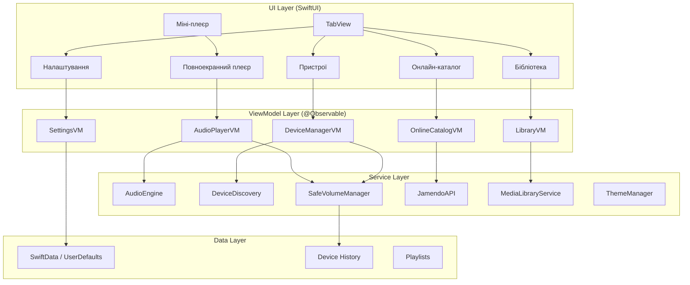

# 🎧 Safe Volume Handoff — Проєктний План iOS Додатку

## Огляд Проєкту

**Safe Volume Handoff** — повноцінний музичний плеєр для iOS, головною фішкою якого є **безпечне перемикання аудіо на зовнішні пристрої** з попереднім контролем гучності.

Додаток вирішує реальні проблеми, виявлені в [дослідженні Spotify Connect](file:///Users/dronchik/Documents/GitHub/Safe-Volume-Handoff/Лаба%201%20ЛМВ.pdf):

| Проблема з дослідження | Наше рішення |
|---|---|
| Непередбачуваний рівень гучності при підключенні (П2, П9) | Попередній перегляд гучності + діалог підтвердження |
| Страх раптового гучного звуку ввечері | Night Mode з автоматичним обмеженням гучності |
| Колонка грає на своєму попередньому рівні | Fade-in + максимальний поріг |
| Неможливість швидко зупинити звук (П4) | Аварійна кнопка STOP |
| Хибний workaround: скручування гучності телефону | Історія пристроїв із запам'ятовуванням рівня |

---

## Технічний Стек

| Компонент | Технологія |
|---|---|
| Платформа | iOS 26+ |
| Мова | Swift 6 |
| UI Framework | SwiftUI |
| Архітектура | MVVM + `@Observable` macro |
| Аудіо | AVFoundation + MediaPlayer |
| Пристрої | AVRoutePickerView (AirPlay) + CoreBluetooth |
| Онлайн-каталог | Jamendo API (безкоштовний) |
| Локальна музика | MPMediaLibrary (бібліотека iPhone) |
| Зберігання | SwiftData / UserDefaults |
| Мова інтерфейсу | Українська 🇺🇦 |

---

## Тестування на iPhone

> [!TIP]
> **Безкоштовне тестування на фізичному iPhone** — повністю можливо!
> 
> 1. Створіть безкоштовний Apple ID
> 2. Додайте його в Xcode → Settings → Accounts
> 3. В проєкті виберіть Team → ваш Personal Team
> 4. Підключіть iPhone кабелем, натисніть Run
> 5. На iPhone: Settings → General → VPN & Device Management → Trust
> 
> **Обмеження**: додаток потрібно перевстановлювати кожні 7 днів, максимум 3 активні додатки.

---

## Архітектура Додатку



---

## Структура Проєкту

```
SafeVolumeHandoff/
├── SafeVolumeHandoffApp.swift          # Точка входу
├── ContentView.swift                    # TabView + міні-плеєр
│
├── Theme/
│   ├── ThemeManager.swift               # Система тем (не захардкоджена)
│   ├── AppColors.swift                  # Палітра кольорів
│   └── AppFonts.swift                   # Типографіка
│
├── Models/
│   ├── Track.swift                      # Модель треку
│   ├── Playlist.swift                   # Модель плейлиста
│   ├── AudioDevice.swift                # Модель аудіопристрою
│   ├── DeviceHistory.swift              # Історія підключень з гучністю
│   └── SafeVolumeConfig.swift           # Конфігурація safe mode
│
├── ViewModels/
│   ├── AudioPlayerViewModel.swift       # Керування відтворенням
│   ├── DeviceManagerViewModel.swift     # Виявлення та підключення пристроїв
│   ├── LibraryViewModel.swift           # Бібліотека iPhone
│   ├── OnlineCatalogViewModel.swift     # Jamendo API
│   └── SettingsViewModel.swift          # Налаштування
│
├── Services/
│   ├── AudioEngine.swift                # AVAudioPlayer / AVAudioSession
│   ├── DeviceDiscoveryService.swift     # AirPlay + Bluetooth discovery
│   ├── SafeVolumeManager.swift          # 🔑 КЛЮЧОВИЙ: логіка safe handoff
│   ├── FadeInEngine.swift               # Плавне наростання гучності
│   ├── NightModeManager.swift           # Часовий профіль
│   ├── JamendoAPIService.swift          # HTTP-клієнт для Jamendo
│   ├── MediaLibraryService.swift        # Доступ до MPMediaLibrary
│   └── HapticFeedbackService.swift      # Вібрація при подіях
│
├── Views/
│   ├── Library/
│   │   ├── LibraryView.swift            # Таб бібліотеки
│   │   ├── TrackListView.swift          # Список треків
│   │   ├── TrackRowView.swift           # Рядок треку
│   │   └── PlaylistView.swift           # Вигляд плейлиста
│   │
│   ├── OnlineCatalog/
│   │   ├── OnlineCatalogView.swift      # Таб онлайн-каталогу
│   │   ├── SearchView.swift             # Пошук по Jamendo
│   │   └── OnlineTrackRow.swift         # Рядок онлайн-треку
│   │
│   ├── Player/
│   │   ├── MiniPlayerView.swift         # Міні-плеєр внизу
│   │   ├── FullPlayerView.swift         # Повноекранний плеєр
│   │   ├── AlbumArtView.swift           # Обкладинка з адаптивним фоном
│   │   ├── PlaybackControlsView.swift   # Кнопки play/pause/skip
│   │   ├── ProgressBarView.swift        # Прогрес-бар
│   │   ├── VolumeSliderView.swift       # Повзунок гучності
│   │   └── EmergencyStopButton.swift    # 🔴 Аварійна кнопка STOP
│   │
│   ├── Devices/
│   │   ├── DevicesView.swift            # Таб пристроїв
│   │   ├── DeviceCardView.swift         # Картка пристрою
│   │   ├── DeviceVolumePreview.swift    # Попередній перегляд гучності
│   │   ├── HandoffConfirmSheet.swift    # 🔑 Діалог підтвердження
│   │   └── HandoffAnimationView.swift   # Анімація передачі
│   │
│   └── Settings/
│       ├── SettingsView.swift           # Таб налаштувань
│       ├── NightModeSettings.swift      # Налаштування нічного режиму
│       ├── FadeInSettings.swift         # Тривалість fade-in
│       ├── VolumeLimitSettings.swift    # Макс. поріг гучності
│       └── ThemeSettings.swift          # Налаштування теми
│
├── Components/
│   ├── AdaptiveBackground.swift         # Фон на основі обкладинки
│   ├── GlowingButton.swift              # Кнопка з ефектом свічення
│   ├── AnimatedWaveform.swift           # Анімована хвиля
│   └── SafetyIndicator.swift            # Індикатор безпеки (зелений/жовтий/червоний)
│
└── Extensions/
    ├── Color+DominantColor.swift        # Витягування домінантного кольору
    ├── View+Transitions.swift           # Кастомні переходи
    └── AVAudioSession+SafeVolume.swift  # Розширення аудіосесії
```

---

## Ключові Екрани

### 1. 📚 Бібліотека (Library Tab)
- Список локальних треків з бібліотеки iPhone
- Плейлисти (створення, редагування)
- Пошук по назві / виконавцю
- Сортування (за назвою, датою, виконавцем)

### 2. 🌐 Онлайн-каталог (Online Tab)  
- Пошук треків через **Jamendo API** (безкоштовна ліцензована музика)
- Жанри / категорії
- Прослуховування + додавання до локальних плейлистів

### 3. 🎵 Плеєр (Now Playing)
- **Міні-плеєр** — завжди видимий внизу, показує поточний трек
- **Повноекранний плеєр** — відкривається плавною анімацією з міні-плеєра:
  - Обкладинка альбому з **адаптивним фоном** (домінантний колір)
  - Прогрес-бар із можливістю перемотки
  - Play/Pause, Skip, Previous
  - Повзунок гучності з індикатором безпеки
  - 🔴 **Аварійна кнопка STOP** — велика червона кнопка для миттєвої зупинки
  - Іконка поточного пристрою (натискання → перехід до пристроїв)

### 4. 📡 Пристрої (Devices Tab) — **ГОЛОВНИЙ ЕКРАН ПРОЄКТУ**
Це серце додатку — тут реалізовані всі UX-рішення з дослідження:

```
┌─────────────────────────────────┐
│  📡 Пристрої                    │
│                                  │
│  ▶ Цей iPhone          🟢 100% │
│  ─────────────────────────────  │
│                                  │
│  Доступні пристрої:              │
│                                  │
│  ┌─────────────────────────────┐│
│  │ 🔊 JBL Flip 6               ││
│  │ Bluetooth · Кімната          ││
│  │ Остання гучність: 35%        ││
│  │ ●───────○──────────── 35%    ││
│  │                              ││
│  │ [🟢 Підключити безпечно]     ││
│  └─────────────────────────────┘│
│                                  │
│  ┌─────────────────────────────┐│
│  │ 📺 Samsung TV                ││
│  │ AirPlay · Вітальня           ││
│  │ Остання гучність: 72%        ││
│  │ ●──────────────○──── 72%     ││
│  │ ⚠️ УВАГА: Висока гучність   ││
│  │ [🟡 Підключити з обережністю]││
│  └─────────────────────────────┘│
│                                  │
│  🌙 Нічний режим: УВІМК (22:00) │
│  📊 Макс. поріг: 40%            │
└─────────────────────────────────┘
```

#### Діалог підтвердження (HandoffConfirmSheet):
```
┌─────────────────────────────────┐
│        Підключити до            │
│      🔊 JBL Flip 6?            │
│                                  │
│  Поточна гучність пристрою:     │
│  ●────────○────────────── 35%   │
│                                  │
│  🟢 Безпечний рівень            │
│                                  │
│  ⏱ Fade-in: 2 секунди           │
│  🌙 Нічний режим: увімк         │
│  📊 Макс. поріг: 40%            │
│                                  │
│  ┌─────────────────────────────┐│
│  │   ✅ Підключити безпечно     ││
│  └─────────────────────────────┘│
│                                  │
│         Скасувати               │
└─────────────────────────────────┘
```

### 5. ⚙️ Налаштування (Settings Tab)
- **Нічний режим**: увімк/вимк, час активації (напр. 22:00–08:00)
- **Fade-in**: тривалість (0.5с – 5с), увімк/вимк
- **Максимальний поріг**: % при першому підключенні
- **Тема**: чорний фон + червоно-оранжевий акцент (з можливістю зміни)
- **Про додаток**: інформація, посилання на дослідження

---

## 7 Ключових Safe Volume Handoff Функцій

### 1. 🎚️ Попередній перегляд гучності
Показує повзунок гучності цільового пристрою **ДО** підключення в картці пристрою. Дозволяє відрегулювати рівень до початку відтворення.

### 2. 📈 Fade-in за замовчуванням
Плавне наростання звуку при перемиканні — від 0% до обраного рівня за налаштовуваний час (0.5с — 5с).

### 3. 🔴 Аварійна кнопка STOP
Велика червона кнопка на екрані плеєра — миттєва зупинка всього аудіо в один клік. Ніяких меню, ніяких підтверджень.

### 4. 📊 Максимальний поріг гучності
Налаштовуваний ліміт максимальної гучності при першому підключенні (напр. 40%). Якщо пристрій запам'ятав 80%, додаток не дозволить стартувати вище порогу.

### 5. 🌙 Night Mode (Нічний режим)
Автоматично вмикається у вечірній/нічний час. Зменшує максимально допустиму гучність (напр. до 30%), додає обов'язковий fade-in.

### 6. ✅ Діалог підтвердження
Перед підключенням показується картка пристрою з його ім'ям, кімнатою, рівнем гучності та кнопкою «Підключити безпечно». Колір кнопки залежить від безпеки рівня (🟢🟡🔴).

### 7. 📋 Історія пристроїв
Запам'ятовує переважний рівень гучності для кожного пристрою. Наприклад: «JBL Flip 6 → зазвичай 35%», «Samsung TV → зазвичай 25% ввечері».

---

## Кольорова Схема

Мінімалістична темна тема з двома акцентними кольорами:

| Елемент | Колір | Hex |
|---|---|---|
| Фон основний | Чорний | `#0A0A0F` |
| Фон вторинний | Темно-сірий | `#1A1A24` |
| Фон карток | Графіт | `#242430` |
| Текст основний | Білий | `#F5F5F7` |
| Текст вторинний | Сірий | `#8E8E93` |
| Акцент (безпечно) | Червоно-оранжевий | `#FF6B35` |
| Акцент hover | Яскравий оранж | `#FF8C42` |
| Безпечний рівень | Зелений | `#34C759` |
| Увага (середній) | Жовтий | `#FFD60A` |
| Небезпечний рівень | Червоний | `#FF3B30` |
| STOP кнопка | Яскраво-червоний | `#FF2D55` |

> [!IMPORTANT]
> Всі кольори визначаються через `ThemeManager` і легко змінюються в одному місці!

---

## Jamendo API Інтеграція

[Jamendo](https://developer.jamendo.com/) — безкоштовний API для прослуховування ліцензованої музики (Creative Commons).

**Можливості**:
- Пошук треків за назвою/виконавцем/жанром
- Повне прослуховування (не preview!)
- Обкладинки альбомів
- Безкоштовно для некомерційних проєктів

**API Endpoints**:
```
GET https://api.jamendo.com/v3.0/tracks/?client_id=YOUR_ID&search=query
GET https://api.jamendo.com/v3.0/tracks/?client_id=YOUR_ID&tags=rock
GET https://api.jamendo.com/v3.0/albums/?client_id=YOUR_ID
```

---

## Етапи Розробки

### Фаза 1: Фундамент (Тиждень 1)
- [ ] Створити Xcode проєкт
- [ ] Налаштувати структуру папок
- [ ] Реалізувати `ThemeManager` з палітрою кольорів
- [ ] Базовий `TabView` з 4 табами
- [ ] Моделі даних (`Track`, `AudioDevice`, `Playlist`)

### Фаза 2: Аудіо-движок (Тиждень 1-2)
- [ ] `AudioEngine` — базове відтворення (AVAudioPlayer / AVPlayer)
- [ ] Інтеграція з MediaPlayer framework (Now Playing info)
- [ ] `FadeInEngine` — плавне наростання гучності
- [ ] `SafeVolumeManager` — логіка перевірки рівня безпеки

### Фаза 3: Бібліотека та Плеєр (Тиждень 2)
- [ ] Екран бібліотеки (MPMediaLibrary)
- [ ] Міні-плеєр
- [ ] Повноекранний плеєр з адаптивним фоном
- [ ] Анімація переходу міні→повний плеєр
- [ ] Аварійна кнопка STOP

### Фаза 4: Safe Volume Handoff (Тиждень 3)
- [ ] Виявлення AirPlay-пристроїв
- [ ] Виявлення Bluetooth-пристроїв
- [ ] Екран пристроїв з картками
- [ ] Попередній перегляд гучності
- [ ] Діалог підтвердження підключення
- [ ] Історія пристроїв (SwiftData)
- [ ] Кольорова індикація рівня безпеки

### Фаза 5: Розширений функціонал (Тиждень 3-4)
- [ ] Night Mode з автоматичним розкладом
- [ ] Максимальний поріг гучності
- [ ] Екран налаштувань
- [ ] Jamendo API інтеграція
- [ ] Онлайн-каталог з пошуком
- [ ] Плейлисти

### Фаза 6: Полірування (Тиждень 4)
- [ ] Адаптивний фон на основі обкладинки
- [ ] Мікро-анімації та переходи
- [ ] Тестування на фізичному iPhone
- [ ] Виправлення багів

---

## Зв'язок з Дослідженням

Кожна функція додатку безпосередньо відповідає знахідкам з [лабораторної роботи](file:///Users/dronchik/Documents/GitHub/Safe-Volume-Handoff/Лаба%201%20ЛМВ.pdf):

| Знахідка дослідження | Цитата респондента | Функція додатку |
|---|---|---|
| П2: Страх раптового звуку | R1: *«Вагаюся або відмовляюся вмикати колонку»* | Night Mode + Fade-in |
| П9: Немає контролю до підключення | R3: *«На телефоні зменшую гучність»* | Попередній перегляд гучності |
| Патерн екстреної зупинки | R3: *«Відразу поставила на паузу»* | Аварійна кнопка STOP |
| Хибний workaround | R3: Скручує звук телефону, думаючи це вплине на колонку | Діалог з реальною гучністю пристрою |
| Радикальні методи при збої | R1: *«Виключав та включав блютуз»* | Чітка кнопка від'єднання |
